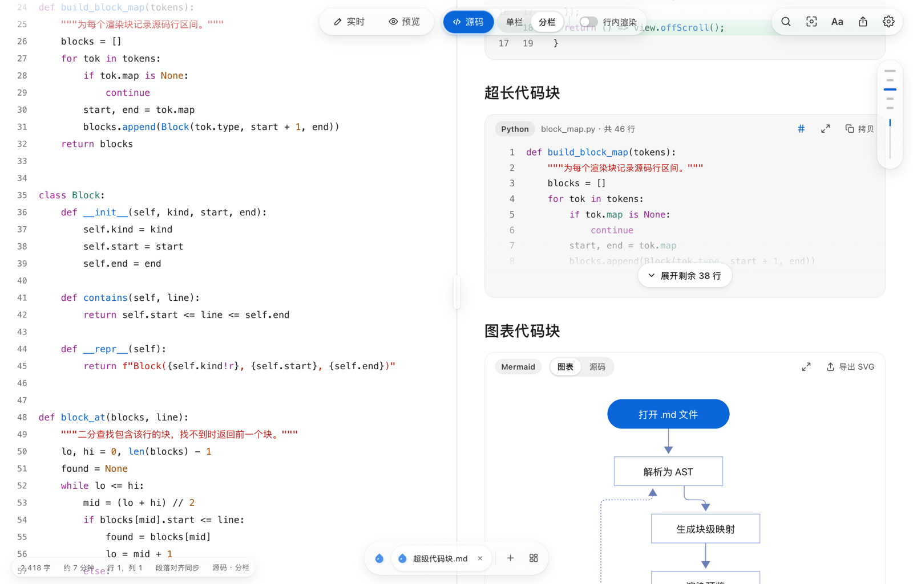

<p align="center">
  
</p>

<h1 align="center">Dew</h1>

<p align="center">
  <strong>A cross-platform desktop Markdown editor that keeps writing and reading quiet.</strong>
</p>

<p align="center">
  <a href="https://github.com/kzheart/Dew/releases/latest"></a>
  <a href="https://github.com/kzheart/Dew/actions/workflows/ci.yml"></a>
  <a href="LICENSE"></a>
</p>

<p align="center">
  <a href="README.md">简体中文</a> | English
</p>

<p align="center">
  
</p>

## Overview

Dew is a simple desktop Markdown editor. Your documents are plain `.md` files on disk.

> [!NOTE]
> The interface is currently available in Simplified Chinese only.

## Features

- **Editing modes**: live WYSIWYG editing, preview, source, and source side by side with the preview.
- **Code blocks**: syntax highlighting, highlighted lines, diffs, folding of long code and one-click copy.
- **Charts and math**: Mermaid, Vega-Lite and PlantUML charts, and LaTeX math.
- **Rich Markdown**: task lists, callouts, footnotes, tables and YAML front matter.
- **Quick insert**: type `/` on an empty line to insert headings, lists, tables, math, charts and more.
- **Smart paste**: web content becomes Markdown, spreadsheet data becomes a table, and pasted screenshots are saved as images.
- **Table editing**: tables stay aligned, and columns can be inserted, moved and resized in place.
- **Export**: PDF, HTML or rich text; code, tables and charts are never cut across printed pages.
- **Share cards**: turn a selection into a polished image to share.
- **Multiple files**: switch between files in one window, see all open files at a glance, and reopen recently closed files where you left off.
- **Quick open**: find and open files by name.

<p align="center">
  
</p>

## Installation

### Platforms

| Platform | Status |
| --- | --- |
| macOS 12 or later (Apple silicon / Intel) | ✅ Supported |
| Windows | 🚧 Planned |

### Download

Download the package for your platform from [Releases](https://github.com/kzheart/Dew/releases/latest). On macOS, open `dew-<version>.dmg` and drag Dew into Applications.

> [!IMPORTANT]
> macOS builds are currently ad-hoc signed and not yet notarized by Apple. If macOS says Dew "can't be opened" or "is damaged" on first launch, run:
>
> ```sh
> xattr -cr /Applications/Dew.app
> ```
>
> or Control-click Dew in Finder and choose Open.

### Build from source

See [Development](#development) below.

## Development

Requires [Go](https://go.dev/) 1.27+ and [Bun](https://bun.sh/) 1.2+.

```sh
bun install          # install dependencies
bun run dev          # run the app in development mode
bun run build        # build and package the app into build/
bun test src         # run the unit tests
```

## Contributing

Issues and pull requests are welcome. Please read the [contributing guide](CONTRIBUTING.md) first; commit messages follow [Conventional Commits](https://www.conventionalcommits.org/).

See [CHANGELOG.md](CHANGELOG.md) for the release history.

## License

[MIT](LICENSE) © 2026 kzheart
