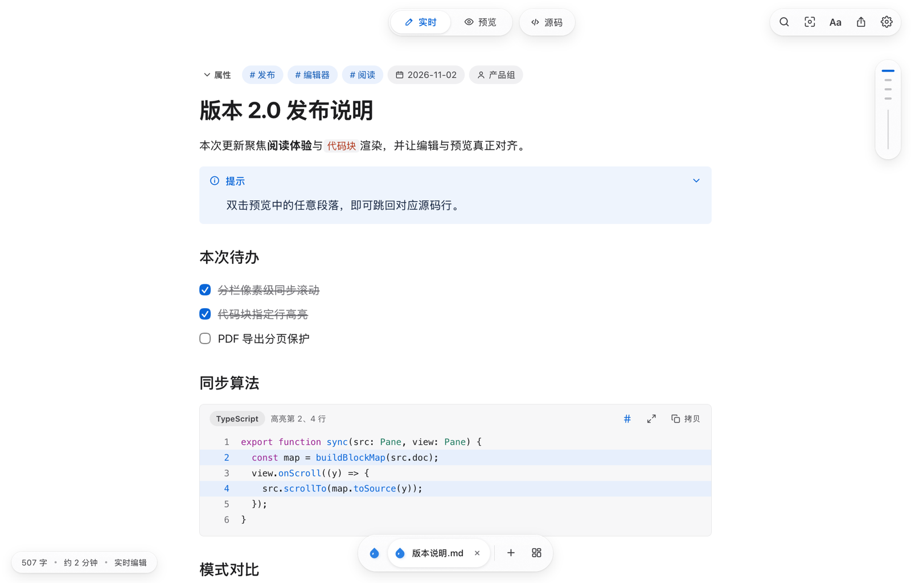
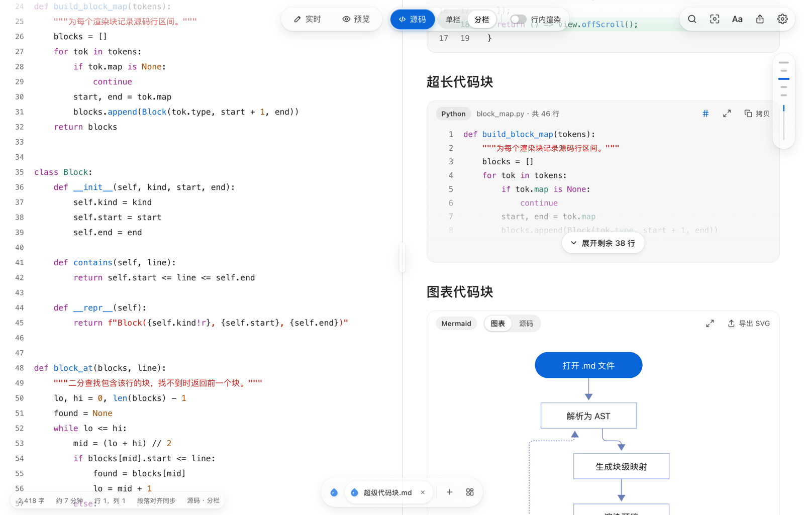

<p align="center">
  
</p>

<h1 align="center">Dew</h1>

<p align="center">
  <strong>一款跨平台的桌面 Markdown 编辑器，让写作与阅读都安静下来。</strong>
</p>

<p align="center">
  <a href="https://github.com/kzheart/Dew/releases/latest"></a>
  <a href="https://github.com/kzheart/Dew/actions/workflows/ci.yml"></a>
  <a href="LICENSE"></a>
</p>

<p align="center">
  简体中文 | <a href="README.en.md">English</a>
</p>

<p align="center">
  
</p>

## 简介

Dew 是一款简洁的桌面 Markdown 编辑器，文档就是磁盘上的普通 `.md` 文件。

## 功能

- **多种编辑模式**：所见即所得的实时编辑、纯预览、源码，以及源码与预览并排对照。
- **代码块**：语法高亮、指定行高亮、diff 显示、长代码自动折叠，一键复制。
- **图表与公式**：支持 Mermaid、Vega-Lite、PlantUML 图表与 LaTeX 数学公式。
- **丰富的 Markdown 语法**：任务列表、提示框、脚注、表格与 YAML 属性。
- **快捷插入**：空行输入 `/` 快速插入标题、列表、表格、公式、图表等内容。
- **智能粘贴**：粘贴网页内容自动转为 Markdown，粘贴表格数据自动生成表格，粘贴截图自动保存为图片。
- **表格编辑**：自动对齐，可直接插入、移动和调整列。
- **导出**：导出 PDF、HTML 或拷贝为富文本，打印时代码块、表格和图表不会被截断。
- **分享卡片**：把选中的内容生成精美图片，便于分享。
- **多文件**：多个文件在同一窗口中切换，可总览全部已打开文件，快速找回最近关闭的文件并回到上次阅读的位置。
- **快速打开**：按名称搜索并打开文件。

<p align="center">
  
</p>

## 安装

### 支持平台

| 平台 | 状态 |
| --- | --- |
| macOS 12 及以上（Apple 芯片 / Intel） | ✅ 已支持 |
| Windows | 🚧 规划中 |

### 下载

前往 [Releases](https://github.com/kzheart/Dew/releases/latest) 下载对应平台的安装包。macOS 用户下载 `dew-<版本号>.dmg`，打开后将 Dew 拖入“应用程序”文件夹。

> [!IMPORTANT]
> macOS 安装包目前使用临时（ad-hoc）签名，尚未经过 Apple 公证。首次打开时如果系统提示“无法打开”或“已损坏”，请在终端执行：
>
> ```sh
> xattr -cr /Applications/Dew.app
> ```
>
> 或在 Finder 中按住 Control 点按 Dew，选择“打开”。

### 从源码构建

参见下文的[开发](#开发)一节。

## 开发

需要 [Go](https://go.dev/) 1.27+ 与 [Bun](https://bun.sh/) 1.2+。

```sh
bun install          # 安装依赖
bun run dev          # 以开发模式启动应用
bun run build        # 构建并打包应用，输出到 build/
bun test src         # 运行单元测试
```

## 参与贡献

欢迎提交 Issue 与 Pull Request。提交代码前请阅读[贡献指南](CONTRIBUTING.md)，提交信息遵循 [Conventional Commits](https://www.conventionalcommits.org/zh-hans/) 规范。

版本变更记录见 [CHANGELOG.md](CHANGELOG.md)。

## 许可证

[MIT](LICENSE) © 2026 kzheart
