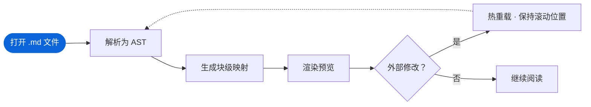
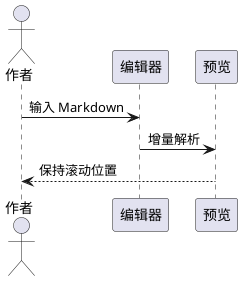

# 超级代码块

Diff 渲染、长代码折叠、图表代码块与灯箱放大。点代码块、表格或图表右上角的放大按钮，可以拖拽平移、滚轮缩放并在块内搜索。

## Git Diff

```diff src/sync.ts
@@ -12,7 +12,9 @@ export function sync
 export function sync(src: Pane, view: Pane) {
-  const ratio = view.height / src.height;
+  const map = buildBlockMap(src.doc);
   view.onScroll((y) => {
-    src.scrollTo(y / ratio);
+    const line = map.toSource(y);
+    src.scrollTo(line);
   });
+  return () => view.offScroll();
 }
```

## 超长代码块

```python block_map.py
def build_block_map(tokens):
    """为每个渲染块记录源码行区间。"""
    blocks = []
    for tok in tokens:
        if tok.map is None:
            continue
        start, end = tok.map
        blocks.append(Block(tok.type, start + 1, end))
    return blocks


class Block:
    def __init__(self, kind, start, end):
        self.kind = kind
        self.start = start
        self.end = end

    def contains(self, line):
        return self.start <= line <= self.end

    def __repr__(self):
        return f"Block({self.kind!r}, {self.start}, {self.end})"


def block_at(blocks, line):
    """二分查找包含该行的块，找不到时返回前一个块。"""
    lo, hi = 0, len(blocks) - 1
    found = None
    while lo <= hi:
        mid = (lo + hi) // 2
        if blocks[mid].start <= line:
            found = blocks[mid]
            lo = mid + 1
        else:
            hi = mid - 1
    return found


def to_source(blocks, offsets, y):
    """把预览中的滚动位置换算成源码行号。"""
    i = max(0, bisect_right(offsets, y) - 1)
    block = blocks[i]
    top, bottom = offsets[i], offsets[i + 1]
    ratio = (y - top) / max(1, bottom - top)
    line = block.start + round(ratio * (block.end - block.start))
    return min(line, block.end)
```

## 图表代码块



```vega-lite
{
  "$schema": "https://vega.github.io/schema/vega-lite/v5.json",
  "description": "各模式的使用占比",
  "data": {
    "values": [
      { "模式": "实时", "占比": 46 },
      { "模式": "预览", "占比": 28 },
      { "模式": "源码", "占比": 15 },
      { "模式": "分栏", "占比": 11 }
    ]
  },
  "mark": { "type": "bar", "cornerRadiusEnd": 4 },
  "encoding": {
    "x": { "field": "模式", "type": "nominal", "sort": null, "axis": { "labelAngle": 0 } },
    "y": { "field": "占比", "type": "quantitative", "title": "占比 (%)" }
  },
  "width": 360,
  "height": 180
}
```



## 表格

| 模块 | 功能 | 触发方式 | 作用视图 |
| --- | --- | --- | --- |
| 视图 | 纯预览 | ⌘1 | 预览 |
| 视图 | 纯编辑 | ⌘2 | 编辑 |
| 视图 | 边编辑边预览 | ⌘3 | 分栏 |
| 代码块 | 灯箱放大 | 点击右上角放大 | 预览 |
| 阅读 | 智能悬浮大纲 | 悬停右侧进度条 | 预览 · 分栏 |
| 阅读 | 聚光灯模式 | 工具栏按钮 | 全部 |
| 编辑 | 斜杠命令 | 输入 `/` | 编辑 · 分栏 |
| 导出 | 选区转分享卡片 | 选中后右键 | 全部 |

| 快捷键 | 实时 | 预览 | 源码 | 源码 · 分栏 | 灯箱 | 表格工具 | 说明 |
| --- | --- | --- | --- | --- | --- | --- | --- |
| ⌘1 | 切换 | 切换 | 切换 | 切换 | — | — | 回到实时编辑，保持当前滚动位置与光标所在块 |
| ⌘2 | 切换 | 切换 | 切换 | 切换 | — | — | 进入沉浸阅读，隐藏源码与所有编辑控件 |
| ⌘/ | 打开源码 | 打开源码 | 关闭源码 | 全屏源码 | — | — | 在渲染视图与 Markdown 源码之间来回切换 |
| ⌥⌘/ | 分栏 | 分栏 | 分栏 | 关闭分栏 | — | — | 左侧源码、右侧预览，两侧按块对齐滚动 |
| Esc | 退出当前块 | — | — | — | 关闭 | 退出 | 关闭灯箱后焦点回到打开它的位置 |
| ⏎ | 换行 | — | 换行 | 换行 | 下一处匹配 | 下一行 | 灯箱搜索框里按 ⇧⏎ 跳到上一处匹配 |
